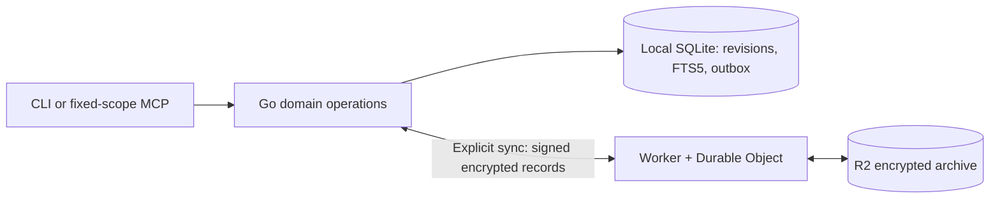

# Capsule Memory

**Securely store and sync existing agent memories and skills across machines and harnesses.**

[](LICENSE)
[](go.mod)
[](docs/v1-status.md)

Capsule Memory securely stores and synchronizes agent memories and skills across machines and harnesses. A shared encrypted archive centralizes durable storage; plaintext, keys, and search stay device-local. Manual workflows leave selection to agents and harnesses. An optional session module adds explicitly enabled conversation capture, local summaries and reviewable memory/decision candidates.

The experimental source includes a Go CLI, scoped MCP, local SQLite search and encrypted synchronization through Cloudflare. The session feature is being integrated on `feat/session-history`; [session status](docs/session-status.md) separates authored source from runtime evidence. The feature defaults off.

> **Source implementation; runtime unverified.** Installs, dependency resolution, formatters, builds, typechecks, tests, and E2E are **NOT RUN**. No infrastructure is deployed. Start with synthetic data; source inspection is not a security audit or runtime acceptance.

[Quickstart](#try-the-source-with-synthetic-data) · [Agent setup prompts](prompts/README.md) · [Agent discovery](docs/agent-discovery.md) · [Documentation](docs/README.md) · [Delivery status](docs/v1-status.md)

## Why Capsule Memory?

Existing agent context should remain available across sessions, machines, and harnesses without requiring a central plaintext search service. Capsule Memory separates local storage, durable encrypted publication, and retrieval so those boundaries stay visible.

- **Work offline:** local writes and their encrypted outbox entries share a SQLite transaction.
- **Keep search on devices:** FTS5 searches local plaintext; the relay receives encrypted content and authorization metadata.
- **Keep history explicit:** immutable revisions, concurrent heads, provenance, and tombstones preserve what changed.
- **Choose the integration:** use the CLI directly or configure a compatible stdio MCP client with one fixed scope.

## What's in the source today?

| Authored capability | Boundary |
| --- | --- |
| CLI capture, recall, history, delete/restore, and index rebuild | SQLite and FTS5 on each trusted device; runtime unverified |
| Official Go SDK MCP tools | Fixed launch scope; store/recall/get/delete, status, and skill list/fetch |
| Signed encrypted manual sync | Explicit CLI `sync`; durable outbox, replay, and retained conflict/deletion history |
| Cloudflare Worker, Durable Object, and R2 adapter | R2 is the first implemented storage adapter; provider behavior unverified |
| Local skill approval and activation | Exact owner-approved Markdown revision, `read-as-text` only; approvals do not sync |

**Optional session source:** Linux/macOS daemon and authenticated local IPC, version-pinned Claude/Codex/T3/import capture, compressed encrypted histories, loopback local inference, reviewable candidates and lifecycle-checked v2 knowledge. Compilation and runtime are **NOT RUN**. See [session history](docs/session-history.md), [status](docs/session-status.md) and [runbook](docs/run-session.md).

**Deferred:** WebSockets, native keystores, automated key rotation, embeddings, published-body cache eviction, Git automation and executable skill installation. Harness/platform compatibility remains unverified. See the [roadmap](docs/roadmap.md).

## Set up with an agent

Give your agent the [prompt index](prompts/README.md) and choose the job. First-time evaluation, a new owner vault, an additional device, and an MCP client have different trust and setup requirements.

| Job | Start here |
| --- | --- |
| Try the project for the first time | [First-run prompt](prompts/01-first-run.md) |
| Create a vault and prepare the central relay | [Owner setup](prompts/02-owner-setup.md) · [Relay setup](prompts/03-relay-setup.md) |
| Join another machine or publishing node | [Device enrollment](prompts/04-enroll-device.md) |
| Connect an existing agent harness | [MCP client setup](prompts/05-connect-mcp.md) |
| Capture/sync, resolve conflicts, recover, review skills or assess security | [Operating prompts](prompts/README.md#choose-a-task) |

A minimal instruction to your agent:

~~~text
Use the trusted https://github.com/humzakhan/capsule-memory checkout.
Read AGENTS.md, prompts/README.md, and docs/v1-status.md.
Choose the prompt for my requested setup or operating task.
Follow my existing execution/data permissions; this instruction grants no
cloud deployment, spending, secret transfer, or unrestricted memory access.
If execution is unavailable, prepare exact commands and label checks NOT RUN.
~~~

For fetch-based agents, [llms.txt](llms.txt) provides a small Markdown reading map. [agent-manifest.json](agent-manifest.json) describes current roles, tools, limits and prompt paths in a project-specific format. Neither is an installer, an MCP registry entry, or a guarantee that agents will discover or ingest the repository.

Read [agent discovery](docs/agent-discovery.md) for the use-case matrix and public-discovery prerequisites. Legacy setup uses explicit CLI sync and local stdio MCP. [Session setup](prompts/11-session-history.md) describes optional daemon/IPC operation. These prompts install no service or hook and expose no hosted MCP endpoint.

## How it fits together



Each device keeps plaintext, content keys, and its search index locally. The relay authenticates devices and orders publication; the archive-head update is the intended durable publication boundary. Optional session background work runs on an explicitly enabled trusted device; there is no cloud plaintext search.

The [architecture](docs/architecture.md) also describes future components. Use the [v1 contract](docs/v1-contract.md) and [delivery status](docs/v1-status.md) for the implemented scope.

## Try the source with synthetic data

Use your own trusted Linux/macOS development machine with Go 1.24.0, Node 22+, and npm. Platform compatibility is unverified. Allow roughly 15–30 minutes for initial dependency resolution/build and 2–5 minutes for the authored E2E journey if the source works.

From a checkout of `main`:

```sh
umask 077
mkdir -p "$HOME/.local/bin"
go mod tidy
go build -o "$HOME/.local/bin/capsule-memory" ./cmd/capsule-memory
cd cloudflare
npm install --save-exact
./node_modules/.bin/wrangler types
cd ..
node e2e/run.mjs --cli "$HOME/.local/bin/capsule-memory"
```

**These commands are NOT RUN.** Dependencies and Wrangler are pinned, but `go.sum` and an npm lockfile are not yet present. The owner must resolve and review them; the first install is not frozen. `wrangler types` generates declarations and does not typecheck the implementation.

The E2E journey uses disposable synthetic device homes and local-only Worker/DO/R2 emulation. No Cloudflare token or deployment is required. Read the [complete runbook](docs/run-v1.md) for setup, retained failure artifacts, and cleanup, and the [E2E guide](e2e/README.md) for assertions and limits. Local emulator success would not establish production durability or security.

### Capture and recall locally

First follow [runbook steps 3–4](docs/run-v1.md#3-initialize-a-separate-manual-demo) to initialize a private demo home and obtain its opaque scope ID. Replace both placeholders below with those values:

```sh
"$HOME/.local/bin/capsule-memory" --home /absolute/private/device-home store \
  --scope YOUR_OPAQUE_SCOPE_ID --text 'Synthetic demo: orchard meeting notes.'
"$HOME/.local/bin/capsule-memory" --home /absolute/private/device-home recall \
  --scope YOUR_OPAQUE_SCOPE_ID --query orchard
"$HOME/.local/bin/capsule-memory" --home /absolute/private/device-home status
```

CLI `store` returns record, revision, and operation IDs plus `local_durable:true` and `published:false`. Recall returns visible revision hits with provenance, conflict state, and coverage. Remote publication requires explicit `sync --scope YOUR_OPAQUE_SCOPE_ID` against the configured relay; local acknowledgement is not a remote backup. There are no separate CLI `push` or `pull` commands.

New profiles default to the OS user-config directory under `capsule-memory`. Existing users must pass `--home /previous/private/path` to reuse their pre-rename profile; nothing is moved or discovered automatically. See [rename compatibility](docs/renaming.md) for previous default paths and retained protocol labels.

### Connect a scoped MCP client

Configure a compatible client to launch this command and argument list. Replace every placeholder with an absolute path or the initialized scope ID; clients differ in their surrounding configuration format.

```json
{
  "command": "/absolute/path/to/capsule-memory",
  "args": ["--home", "/absolute/private/device-home", "mcp", "--scope", "YOUR_OPAQUE_SCOPE_ID"]
}
```

The server exposes `memory_store`, `memory_recall`, `memory_get`, `memory_delete`, `sync_status`, `skill_list`, and `skill_fetch`. Its scope is fixed at launch and grants write/delete authority within that scope. No MCP sync, enrollment, approval, or activation tool is exposed. See [Go client and MCP usage](docs/go-client.md#mcp-and-staged-skills) for exact inputs and skill trust behavior. No particular harness integration has been runtime-verified.

## Privacy and trust limits

- **Protect device homes.** SQLite, FTS5, and cached content are plaintext. Secrets use restricted local files, not native keychains. Keep homes and backups outside checkouts, shared directories, and cloud sync folders; use disk encryption.
- **Encryption has boundaries.** The source uses AES-256-GCM and Ed25519, but cryptographic interoperability and runtime security remain unverified. The relay sees opaque identity/scope metadata and traffic patterns. A compromised trusted endpoint can read its content.
- **Deletion preserves history.** Tombstones hide normal retrieval; explicit history can expose preserved plaintext. Physical erasure is not implemented. Losing all keys and recovery copies is unrecoverable; unsynced writes lost with a device cannot be recovered from R2.
- **Treat retrieved text as untrusted.** Skill approval/activation selects local Markdown for reading only. Fetching content grants no authority to execute it or install scripts. Provider freshness, account loss, and independent backups need separate consideration.

Read the [threat model](docs/threat-model.md) and [security policy](SECURITY.md) before evaluating sensitive use.

## Find your next step

| Need | Read |
| --- | --- |
| Build, synthetic demo, recovery, cleanup | [Run v1](docs/run-v1.md) |
| CLI/MCP flags and results | [Go client](docs/go-client.md) |
| Agent setup, discovery and operating prompts | [Prompt index](prompts/README.md) · [Discovery guide](docs/agent-discovery.md) |
| Evidence and missing acceptance checks | [V1 status](docs/v1-status.md) · [Source inspection](docs/v1-inspection.md) |
| Design, protocol, provider assumptions | [Documentation index](docs/README.md) |
| Contribute, ask for help, report a vulnerability | [Contributing](CONTRIBUTING.md) · [Support](SUPPORT.md) · [Security](SECURITY.md) |

## License

[MIT](LICENSE) · Copyright 2026 Humza Khan. Third-party dependencies retain their own licenses.
