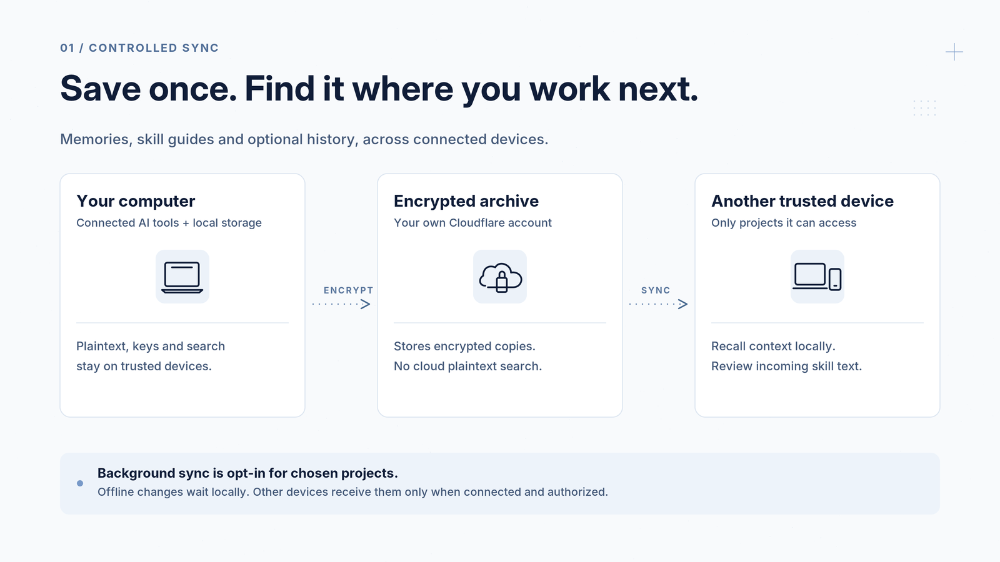
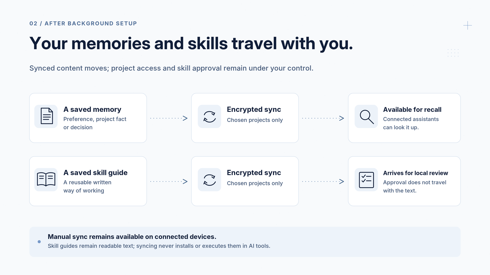
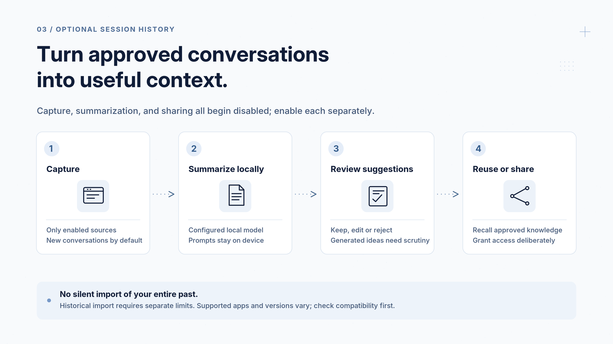

# Capsule Memory

**Less repeating yourself. More continuity with your AI assistants.**

[](docs/releases.md)
[](LICENSE)

Capsule Memory helps you keep useful memories, reusable skill guides and optional conversation history available across your computers and AI tools. Your saved context can follow you from one project or device to the next, while readable content, encryption keys and search stay on your trusted devices.

**Public beta · Build from source.** Start with sample data. Mac and Cloudflare checks have passed within a documented scope; broader platform compatibility and independent security review remain incomplete. [Release notes and validation](docs/releases.md).

[Get started](#get-started) · [How sync works](#how-sync-works) · [Conversation history](#optional-conversation-history) · [Our agents](#use-it-with-our-agents) · [Documentation](docs/README.md)



## How it helps your everyday work

- **Explain yourself less.** Save preferences, project facts and decisions so a connected assistant can look them up next time.
- **Switch computers with less friction.** Find previously synced context on another authorized device instead of copying notes by hand.
- **Reuse your preferred way of working.** Keep written skill guides for tasks such as reviewing code, preparing a report or planning a project.
- **Keep moving while offline.** Save locally, then synchronize when the connection returns and sync is permitted. A local save becomes a remote copy only after successful publication.
- **Keep a trail of what changed.** Inspect earlier versions, preserve conflicting edits and see where saved information came from.

For example: save a project's reporting preferences on your desktop, sync them, then ask a connected assistant on your laptop to recall them. The assistant needs an explicit connection to Capsule Memory; saving a note does not automatically insert it into every app or conversation.

## How sync works

A **memory** is a saved note: a preference, project fact or decision. A **skill** is a reusable written guide explaining how you want a task approached.

Once you enable background sync, Capsule Memory's local background process—the **daemon**—periodically uploads and downloads saved records for the projects you select. This includes both memories and skill text. You choose which devices have access; nothing starts syncing just because you install the software.



What to expect after setup:

- **Automatic, within your choices.** The daemon must be running and connected on participating Linux/macOS devices. Only authorized project collections you enable for publication are uploaded. Windows retains manual operation.
- **Skills sync as text.** Incoming guides wait for review. Approval and activation require the owner’s authority on that device; those approvals do not sync between devices. Capsule Memory does not install skills into your AI app or execute their instructions.
- **Offline changes wait.** Unsent records remain on the originating device. After a successful upload, other authorized devices can download them when they reconnect. Concurrent edits remain visible for resolution.
- **Manual sync is available.** You can explicitly sync a chosen collection without enabling background publication. See the [sync and recovery guide](docs/go-client.md#manual-synchronization-and-recovery).

“All your memories” means the records you or a connected assistant save through Capsule Memory and choose to share. It does not automatically read every app, copy every file or import your entire conversation history.

## Optional conversation history

If you want more than individually saved notes, you can separately enable conversation capture and local summaries.



1. **Choose what to capture.** Version-specific adapters exist for Claude, Codex and T3, plus explicit transcript imports. Capture starts with future conversations; importing older history requires separate limits. App/version compatibility is partial.
2. **Summarize on your device.** An explicitly configured local model can produce session summaries and project overviews. The model server requires separate setup; Capsule Memory does not send transcripts to a cloud model.
3. **Review useful suggestions.** Keep, edit or reject proposed memories and decisions. Personal overviews and sharing into a different vault (encrypted archive) require additional authorization.

Capture, background uploads, summaries, accepting suggestions automatically and sharing across vaults are separate controls, all off initially. Summaries can be wrong; evidence and freshness information help you judge them. Withdrawing capture consent holds unpublished automatic descendants, but cannot instantly recall content already sent or copied.

[Session setup](prompts/11-session-history.md) · [Compatibility and limits](docs/session-status.md)

## Get started

This beta still needs a technical setup: a trusted computer, a source build and, for synchronization, your own Cloudflare account and relay. There is no hosted service or click-to-install app yet. You can try the local sample-data journey without a Cloudflare account.

**The easiest starting point is to ask your assistant to walk through setup:**

```text
Help me evaluate Capsule Memory from https://github.com/humzakhan/capsule-memory.
Read AGENTS.md and prompts/README.md. Start with the first-run guide and sample data.
Explain where my data and keys will live, then help configure only the projects
and devices I choose. Ask before importing real histories, deploying cloud
resources, spending money or granting access. Do not put secrets into this chat.
```

Choose the guide for your next step:

| I want to… | Start here |
| --- | --- |
| Try it with sample data | [First-run guide](prompts/01-first-run.md) |
| Set up my encrypted archive | [Owner setup](prompts/02-owner-setup.md) and [Cloudflare setup](prompts/03-relay-setup.md) |
| Add another computer | [Device enrollment](prompts/04-enroll-device.md) |
| Connect an AI assistant | [MCP connection guide](prompts/05-connect-mcp.md) |
| Enable background sync or conversation capture | [Daemon setup](docs/daemon.md) and [session guide](prompts/11-session-history.md) |

A compatible assistant connects through **MCP**, a standard way for AI tools to call local tools. You can also use the command line directly. Each connection has specific access; there is no public remote MCP service.

<details>
<summary>Building it yourself</summary>

Use Go **1.26.10**, Node **22+** and npm with the committed dependency locks. Follow the [build and sample-data runbook](docs/run-v1.md) for installation, validation and cleanup, or the [session runbook](docs/run-session.md) for optional background features. Those guides preserve dated historical evidence; [release readiness](docs/releases.md) identifies the current checks and remaining limits.

</details>

## Use it with our agents

[Agent Workspace](https://github.com/humzakhan/agent-workspace) is our companion repository for agent packages, shared skills and working conventions. **It is currently private; repository access is required.** Capsule Memory can also be used independently with the command line or a compatible MCP client.

The workspace helps define how an agent works; Capsule Memory stores and synchronizes the context you save. Linking an agent does not automatically import its files or authorize it to execute retrieved skills. For this project's setup and operating prompts, use the public [agent guide](prompts/README.md).

## Your data and your control

- **Encrypted remotely, readable locally.** The shared archive stores encrypted records. Your local database, search index, summaries and key files need protection; use disk encryption and private backups. The relay can still see routing identifiers, sizes and timing.
- **Choose access carefully.** Devices and assistant connections receive specific permissions. Losing all keys and recovery copies can make data unrecoverable. Unsent work lost with a device cannot be recovered from the archive.
- **Deletion retains history.** Deleted records disappear from normal recall, while history and earlier copies can remain. Deletion and revocation are not physical erasure. Old local copies are not automatically cleaned up.
- **Treat recalled content as information.** A saved memory, skill or generated summary does not grant permission to run commands or take actions. Historical or incompletely synchronized results may be stale; a live freshness check can fail when a source is offline.

[Privacy and threat model](docs/threat-model.md) · [Private security reporting](SECURITY.md) · [Known limits and QA](docs/releases.md)

## Learn more

[Documentation](docs/README.md) · [CLI and MCP reference](docs/go-client.md) · [Architecture](docs/architecture.md) · [Support](SUPPORT.md) · [Contribute](CONTRIBUTING.md) · [Roadmap](docs/roadmap.md)

For agents reading the repository: [AGENTS.md](AGENTS.md), [llms.txt](llms.txt) and [capability metadata](agent-manifest.json) describe the interfaces and boundaries. They are not installers or access grants.

## License

[MIT](LICENSE) · Copyright 2026 Humza Khan. Third-party dependencies retain their own licenses.
