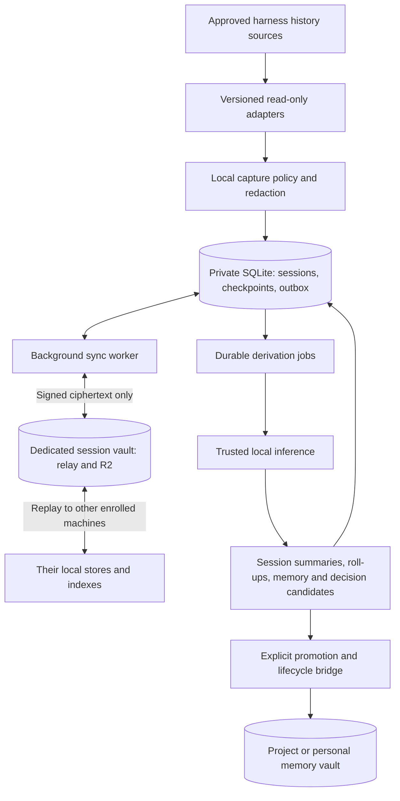

# Opt-in session history and derived memories

**Status: source implementation in progress, 2026-10-26; runtime NOT RUN.** The proposal below is preserved as design context. The authoritative implementation amendments immediately below supersede conflicting proposal wording. Existing manual memory and skill workflows remain available without enabling the module. See [source status](session-status.md) and the [owner runbook](run-session.md).

## Accepted implementation amendments

Every schema-v2 record is compressed with a fresh raw DEFLATE stream **before encryption and upload**, then padded to 4 KiB. The outer legacy v1 envelope and signing/AAD domains are unchanged. Decoder bounds are 1 MiB; writers bound the entire decoded revision to 896 KiB, check padding, decompressor EOF and trailing bytes, and persist exact retry ciphertext. Legacy memory/skill bytes stay unframed. Compression ratios and timing still leak metadata; redaction runs first and tool bodies default to metadata only.

Promoted assertions are schema-v2 `knowledge`, never v1 memory copies. Content, target lifecycle and the owner-signed bridge grant share the same project/personal scope. Every retrieval checks lifecycle and exact target revision. Strict mode requires a source replay started during the request plus visible exact dependency heads, bounded to ten seconds; offline, busy, incomplete and target-only reads hide strict results. Historical results carry `current:false` unless freshly checked, plus last verified coverage. A 24-hour re-attestation cadence is not a freshness guarantee. Cross-vault deletion is asynchronous and cannot recall already disclosed text.

Personal aggregation requires an owner-signed grant and destination readers must have every input scope. Proposed grant changes, rollup execution and commit all enforce that subset. Replayed jobs require current author grants. Source deletion/supersession invalidates the transitive dependency graph; overflow aborts the whole operation. Explicitly retained insights become independent owner-key-authorized assertions
with a proof bound to their exact new revision and proof-free content digest,
no generator or evidence. Ordinary review is writer-attested, not owner proof.
Manual projection withdrawal is terminal for that link; re-promotion needs a new
explicit request. Generation-bound leases and observed parents fence old work.
Consent withdrawal holds unpublished automatic descendants, including target
exports at publish-time source consent checks. All exact consumed prompt events
participate in influence invalidation, independently of selected citations.

The daemon is Linux/macOS only. T3 uses owner-configured, broad read-token HTTP access to pinned allowlisted history routes; no token is discovered or minted. Claude and Codex disk formats are version-pinned and unverified; Codex App Server is not spawned. Generic imports preserve declared origin and suppression. All controls are off initially. Cross-vault setup remains `off` or explicitly `enabled_unaccepted`; published plaintext cache eviction is visibly `not_implemented`. No service, hook, model, credentials or infrastructure has been installed or used by this source work.

The session archive preserves the evidence. Derived summaries make it navigable. Accepted memories make selected knowledge useful in other projects. Each layer has its own permissions, provenance, and lifecycle.

## Recommendation and scope

Use one dedicated personal **session vault** across enabled machines, with project scopes inside it. Keep the existing **memory vault** for selected project and personal knowledge. Both use the same storage and synchronization engine; neither requires a central plaintext service or a Git repository of conversations.

Capture, encrypted publication, local derivation, and promotion into another scope or vault are independent opt-ins. Once configured, the machine daemon performs enabled work automatically, including retry after restart. Automatic deduction produces labelled candidates; accepting them as durable knowledge is a separate operation.

This extends the current product boundary: [architecture](architecture.md) and README currently assign memory selection entirely to harnesses and agents. [Proposed decision 0004](decisions/0004-session-history.md) describes the optional extension. It does not change v1 behavior or authorize implementation, service installation, real-history access, inference spending, or deployment.

## Existing foundation and required changes

The inspected source is `a08ffd8fb7a2fcd3d0f4b848fb919295d6dbf758`. The [delivery status](v1-status.md) records runtime acceptance as pending.

| Source boundary | Reuse | Required addition |
| --- | --- | --- |
| [Local store](../internal/memory/store.go) | SQLite, revision ancestry, durable exact-envelope outbox, FTS5 | Versioned migrations, session ingestion transactions, dependency visibility, bounded background jobs |
| [Synchronization](../internal/memory/sync.go) | Control-first replay, idempotence, durable archive publication | Daemon scheduling, multi-profile management, fair catch-up and retry without blocking local reads |
| [Record model](../internal/memory/model.go) | Immutable operations and authenticated scope context | Reviewed session/summary/insight schemas; v1 accepts only memory and skill text |
| [Profiles](../internal/memory/profile.go) and relay | Separate vault keys and opaque scope identities | Session-vault provisioning/enrollment; v1 has one vault per profile and one pinned vault per Worker deployment |
| [MCP](../internal/memory/mcp.go) | Fixed caller scope and untrusted-content labels | Separate granted session retrieval; v1 MCP has write/delete authority and is not a passive transcript feed |

V1 has no daemon, capture adapters, generated summaries, or decision extraction. Merely pointing its existing MCP server at a session directory would not provide these features.

## Vaults and project identity

| Layout | Trade-off |
| --- | --- |
| **Dedicated session vault, recommended** | Independent content keys, enrollment, backup policy, and raw-history access. Requires a second profile and, with the present relay design, a separately configured Worker deployment. |
| One vault with distinct scopes | Less setup and the same engine. Requires carefully limited scope keys and caller grants; it must not expose raw history to every ordinary memory client. |
| Independent vault for every project | Stronger administrative separation, but multiplies enrollment and explicit aggregation/export work. Reserve for projects with different trust requirements. |

Separation is enforced by keys and grants. The current device-enrollment helper copies all configured scope keys into a new device profile; selective grants need an explicit owner workflow before claiming isolated per-project enrollment. The current control format also caps a vault at 64 scopes. Do not silently merge projects or widen access when that limit is reached.

A locally approved project registry maps each machine's repository paths and worktree aliases to an opaque stable project ID and its scope. A matching directory basename or Git remote is a suggestion, not authority to merge identities. Private paths, remote URLs, project names, session titles, and branch names belong inside encryption; machine-specific paths need not sync.

Unknown projects remain excluded until mapped. If a session changes working directory or spans projects, split attributable events under the approved policy or hold the ambiguous range locally. An excluded project's text must not enter an allowed project's archive through a parent session, tool result, or roll-up. Child sessions inherit restrictions and retain their parent links.

## Machine service and data flow

Run one Go daemon per OS user, managing isolated profiles with one write owner per database. Linux user services and macOS launch agents are packaging targets, subject to platform acceptance. Stdio MCP and the CLI call a user-restricted local IPC API when daemon mode is enabled. Never expose a new network MCP listener as part of capture.

Separate ingestion, publication, replay, indexing, and inference queues. Slow inference or an offline relay must not block capture or interactive recall. Do network and model work outside database write transactions. The current service mutex covers network synchronization; wrapping it in a timer is insufficient for responsive daemon operation and requires refactoring.

File notifications and optional harness hooks only wake the importer. Periodic reconciliation repairs missed events. Hooks enqueue a small local hint and return promptly; they never summarize or upload in the harness's foreground path. No hook is required for eventual capture from a retained, supported source.

## Capture contract and harness adapters

An adapter exposes bounded discovery and `ReadChanges(source, checkpoint)` operations, returning events, a proposed checkpoint, source generation, adapter version, and a coverage report. The checkpoint becomes committed only with the corresponding durable archive work. Adapters read histories; they do not alter harness state, resume sessions, or share a harness's live database connection.

| Adapter | Proposed route and evidence | Acceptance limitation |
| --- | --- | --- |
| Claude Code | Its [official hooks reference](https://code.claude.com/docs/en/hooks) exposes session and transcript identities. Read the approved transcript source incrementally; optional lifecycle hints reduce latency. | Transcript writes are asynchronous, so a stop hook does not establish a complete final transcript. Reconcile after the hint and preserve subagent lineage. |
| Codex | [Official App Server documentation](https://learn.chatgpt.com/docs/app-server) describes stored-thread listing and paginated turn/item history without resuming the thread. Prefer a supported read/export connection; a file adapter is a pinned-version fallback. | Enumerate enabled source kinds and archived threads explicitly. Validate API capabilities and whether access starts any supporting process; do not attach to or mutate an active owner's session implicitly. |
| T3 Code | Prefer an owner-authorized history export/read API that includes user messages, assistant messages, and relevant activity. Preserve provider thread/item IDs where available. | Tools available to this conversation do not establish a standalone daemon API. Inspect the implementation/export contract during adapter work; do not open or copy its live database here. |
| Other harnesses | Add an adapter for a documented export or retained local format. For example, [OpenCode documents session JSON export](https://dev.opencode.ai/v2/docs/cli/commands/). | Version and fixture each adapter. Unsupported, ephemeral, or already-pruned content is reported as unavailable. No universal capture promise. |

These are integration routes inferred from documentation checked on 2026-10-26, not verified Capsule Memory integrations. The MVP targets the user's T3 Code, standalone Claude Code, and standalone Codex histories; other adapters follow demonstrated demand.

Archive the supported user/assistant conversation faithfully after configured redaction. Tool names, status, and linkage are the default tool metadata; detailed tool inputs/outputs, file bodies, and attachments require additional opt-in because they can contain credentials or large private artifacts. Preserve exact allowed source event material where the adapter supports it. Record every omission, truncation, and redaction; do not label a filtered conversation a byte-for-byte native backup.

Do not collect credential stores, environment dumps, or unrelated files referenced by a tool. Native export preservation is a separate capture mode and must respect the same exclusions. A transcript archive supports recall and evidence; universal cross-harness execution resumption, filesystem recreation, and recovery of unrecorded messages are outside this design.

### Identity and incremental import

Register a stable source-store identity for each approved harness profile. Session identity combines that identity, harness, and native session ID; event identity uses a native event ID when available. A durable local mapping assigns opaque archive record IDs. Exports retain origin identities inside encryption so re-imports can be recognized across machines.

For sources without event IDs, use a persisted mapping from source generation and stable event position to event identity, checking the allowed-content digest. Reconcile known prefixes across reparses. If an adapter cannot establish identity after a rewrite, retain a separate observed version and report possible duplication rather than discarding evidence by text similarity.

Track file identity, generation, committed byte position, and a bounded prefix fingerprint for append-only sources. Stop before an incomplete JSONL record; retry it later. For API sources, persist pagination/item checkpoints and re-read an overlapping tail to catch mutable recent entries. Rotation, truncation, edits, and compaction start a new observed generation or create explicit corrections; they must not silently replace previously archived evidence.

Prefer the T3 adapter for a T3-managed session. If a provider log has a proven matching binding, treat it as a second view and preserve provenance without counting it twice. Matching text alone never proves identity. Copies with divergent continuations become branches; timestamps never choose a winner. Hashes used to compare plaintext stay encrypted or device-local.

## Records and durable boundaries

Use typed records under a reviewed application schema. The following are logical contracts, not new wire schemas or accepted v1 record kinds.

| Record | Essential content inside encryption |
| --- | --- |
| Session manifest | Opaque session/project/source identity, native lineage, branches, chunk references, capture policy/version, lifecycle state, observed coverage and gaps |
| Session chunk | Bounded events with stable event IDs, role/type, turn/tool/parent links, allowed content, source generation, content digest, redaction and omission markers |
| Summary | Session or roll-up level, structured findings, exact source revisions/event ranges, source-head set, gaps, model/prompt/policy versions, generation identity |
| Insight | Memory or decision candidate, assertion, project scope, evidence spans, contradictions, inferred/explicit basis, acceptance state and supersession links |
| Projection link | Approved target scope/vault and record, exported source dependencies, bridge authority, invalidation state and receipts |

Store immutable chunks near 256 KiB as an initial target, bounded by measured encoded envelope size. Split oversized events into explicitly linked pieces or report an omission; never silently truncate. Flush on a short interval or size threshold. Avoid replacing an entire growing transcript each turn or creating a revision per streamed token. Paginate manifests/chunk listings and checkpoint long sessions so history and parent limits remain bounded.

In one SQLite transaction, commit imported chunks and manifest revisions, exact encrypted outbox bytes, source-to-event identity mappings, the committed input checkpoint, and durable derivation/invalidation work. Capture is locally durable only after that commit. No plaintext staging acknowledgement may advance the checkpoint before a durable encrypted publication path exists.

On receipt, validate and atomically apply revisions, visibility and dependency changes, and the replay cursor. A manifest with missing chunks remains incomplete and cannot produce a complete summary. Receipt of an object is insufficient: remote success still requires journal/head publication under the existing archive protocol.

Durable state includes original archive records, import checkpoints, pending exact outbox bytes, job identity/state, export links, and candidate acceptance/rejection. FTS, snippets, and rendered previews are rebuildable. A rebuild never discards an unsent capture or re-accepts a rejected candidate.

## Background summaries and deductions

Keep inference in a separate local worker component controlled by the daemon. It receives bounded permitted text and a strict output schema, with no shell, filesystem tools, network tools, or authority to change capture policy. Retrieved conversation instructions remain untrusted data. Output validation checks citations, structure, size, permitted scope, and source visibility; model confidence alone cannot establish a fact.

Use a configured local model on a trusted enrolled device. A machine without one still captures, syncs, and searches. It can assign derivation to a named trusted enrolled machine through encrypted job records; raw content is available only within that machine's grants. No central cloud summarizer is introduced. External model inference would require a separate explicit content-disclosure policy and budget; it is not a fallback when the local model is unavailable.

Generate these artifacts automatically when derivation is enabled:

1. **Session summaries:** goal, work discussed, claimed versus evidenced outcomes, decisions, unresolved questions, and useful lessons. Generate on observed closure or after an initial 15-minute idle window. Idle is a scheduling hint; a resumed session extends coverage and queues an update.
2. **Project roll-ups:** daily summaries of permitted sessions, active decisions, contradictory evidence, and open work. Cite source sessions as well as intermediate summaries; retain a route to primary evidence so repeated compression does not manufacture certainty.
3. **Personal roll-ups:** optional weekly cross-project findings and reusable patterns. Require explicit aggregation permission for every contributing scope and a separately authorized destination.
4. **Memory and decision candidates:** extract reusable facts, preferences, constraints, lessons, and choices with evidence spans. Keep tentative ideas, rejected alternatives, and user-approved decisions distinct.

Decision state distinguishes `proposed`, `accepted`, `superseded`, and `rejected`; implementation/verification evidence is a separate field. An assistant saying “done” is a recorded claim, not verification. Silence does not establish user acceptance. Imported repository decisions can strengthen evidence only through a separately permitted source reader.

Deduplicate jobs by exact source-head/coverage set, task type, model/prompt/policy version, and destination. A local lease with an attempt token prevents duplicate commits after worker restart. Prefer the originating device for session jobs and a designated device for project/personal roll-ups. Explicit reassignment handles offline owners; correctness must tolerate duplicate work and concurrent output revisions without time-based conflict resolution.

Every enabled daemon may process authorized jobs, but replaying another device's artifact must not schedule the identical derivation again. Exclude generated roll-ups, imported Capsule recall text, and derivation jobs' own conversations from new-evidence counts where provenance identifies them. Retain repeated user endorsement as new evidence while avoiding citation loops.

Default extraction and summaries are automatic; promotion remains reviewable. Rejection persists across model reruns. A later optional policy may accept narrow project-local factual candidates automatically, with an explicit generated label and an audit trail. Cross-project promotion, global preferences, instruction files, executable skills, and authorization changes never follow merely from a candidate's confidence score.

## Retrieval and cross-project reuse

Search local FTS5 over summaries and accepted insights first; expand to cited chunks under the caller's grants. Keep raw-session search a separate explicit capability. A project client receives its granted project knowledge and expressly shared personal knowledge. A personal research client may receive broader approved session scopes. Storage enrollment alone does not grant every connected harness access to the archive.

Proposed operations are scoped session search/read, summary search, candidate list/accept/reject, and capture status. Session retrieval needs a new read grant/profile; the current v1 MCP process is not read-only. Owner policy, source registration, enrollment, cross-project export, and destructive operations remain outside ordinary retrieval tools.

Every result includes source references, generated/accepted state, contradictions, and coverage: source kinds, observed ranges/gaps, source-head set, indexed versus available chunks, last reconciliation, and stale dependencies. A new device builds its own authorized index. Downloading only recent summaries provides partial recall, not full archive search.

For example, a session in project A may yield “this provider requires conditional writes for safe publication.” That lesson is initially a project-A candidate with exact message references. After an explicit sanitized export to shared personal knowledge, project B can retrieve it and inspect the evidence it is permitted to see. Similarity or a shared account never expands B's access automatically.

Ordinary derivation retains the source scope. Combining scopes requires an explicit aggregation grant and a destination whose readers are authorized for all included content. Promotion to broader readers is a deliberate export of the reviewed text. Citations may remain opaque for readers without raw access; do not leak source titles or snippets through inaccessible links. Text returned to a remote agent still reaches that agent's inference provider; encrypted storage does not prevent that disclosure.

### Promotion across vaults

Use a designated trusted bridge with explicit source-read and target-write grants. Commit an encrypted export link and durable bridge job at the source, then create the target projection idempotently and record its receipt. A crash between vaults leaves a recoverable pending projection, not an untracked memory. Target visibility waits for completed linkage and valid dependency state.

The projection carries exact dependencies and an authorized bridge attestation of source visibility/coverage. Edits and deletions enqueue invalidation in the same source transaction; the bridge publishes target invalidations with priority. Target-only replicas validate the bridge's delegated authority and the target lifecycle stream without receiving raw-source keys. Source references alone are insufficient for these replicas.

There is no atomic transaction or instantaneous deletion across two vaults. Return the last verified dependency coverage. Strict retrieval requires the bridge to check dependencies against a freshly reconciled source head; if that check is unavailable, hide the projection. A historical offline view can expose cached output with its last verified coverage, but must not label it current. Cross-vault promotion must stay disabled until bridge authorization, durable retries, invalidation, and target-only recovery pass acceptance. Sessions and local candidates remain useful before this slice ships.

## Consent and privacy controls

All switches start off. Setup previews eligible source locations, project mapping, event classes, estimated historical size, and destination before enabling capture. Default to new activity after an explicit consent checkpoint; historical backfill is a separate bounded selection. An existing active session may require an owner-approved baseline to distinguish new events safely.

| Control | Default and behavior |
| --- | --- |
| Capture | Off per machine/source/project. Explicit includes, deny rules, session exclusions, and pause/resume. Deny wins; unknown formats fail closed. |
| Publication | Off until a destination and permitted scopes are selected. Local-only capture is possible, with no claim of remote backup. |
| Derivation | Off until a trusted inference target, allowed content, and resource budgets are selected. Capture can continue while jobs are blocked. |
| Promotion and aggregation | Off across scopes/vaults. Candidate creation does not modify accepted memory, project instruction files, or skills. |
| Detailed data and retention | Tool bodies/attachments/native exports require separate inclusion. No automatic source deletion or irreversible archive pruning. |

Apply deterministic redaction before persistence, indexing, model input, and encryption. Record the policy version and redaction locations without retaining the removed secret. Secret detection is imperfect; exclusions and conservative data classes remain necessary. A changed redaction rule does not erase content already published under the old rule.

Persist consent and exclusion checkpoints. Pausing means new capture stops; resuming must explicitly skip or include the paused interval rather than quietly backfilling it. Disabling derivation cancels active inference and prevents its late result from committing. Disabling publication retains pending work locally; later re-enabling does not silently publish content whose consent has been withdrawn.

Local SQLite, indexes, model inputs, caches, and backups contain sensitive plaintext and require private directories and device protections. Diagnostic logs contain bounded counts/error codes, not conversations, queries, titles, paths, model prompts, or key material. A daemon handling several profiles does not turn their keys into general harness authority.

## Deletion and invalidation

Deleting a source session creates a tombstone for the logical session and hides all its chunks through a visibility join, even when chunk rows remain. Every descendant summary, roll-up, snippet, candidate, and exported projection must check dependency visibility. Late-arriving chunks and stale imports cannot resurrect the session. Restoring content requires explicit authorization and named deletion ancestry.

Source corrections invalidate affected outputs and requeue bounded regeneration. Invalidation follows the dependency graph transitively, including summary-of-summary roll-ups. Retrieval filters stale derivatives immediately on learning the source change, before asynchronous cleanup finishes. User rejection and accepted human edits survive regeneration.

Deleting a raw source requires withdrawing or revising dependent accepted memories too; acceptance does not detach provenance. Keeping a separately authored independent assertion is a deliberate owner action. Lost access to a source yields an unverified/hidden dependent projection, not an assertion of freshness.

Keep an encrypted suppression ledger keyed by source/session identity so a still-present harness log is not re-imported as a new session after archive deletion. Removing a harness log does not automatically delete its archive. “Stop capture,” “delete archived session,” and “forget derived knowledge” have distinct visible consequences; the session deletion workflow covers dependent knowledge by default.

Tombstones hide normal retrieval; historical ciphertext/plaintext, harness originals, exports, and backups may remain. Physical erasure needs a separate retention/key design and cannot be promised by dropping an index row or rotating a shared scope key. Offline devices apply invalidations after reconnect; previously disclosed text cannot be recalled from a recipient.

## Resource budgets and visible status

Initial scheduling targets are a short capture flush, publication within roughly 30 seconds while active and online, and five-minute jittered reconciliation. They are configurable targets, not delivery guarantees. Laptop sleep, disabled services, quotas, and long backlogs extend them. A full scan is paginated and rate-limited; do not poll every historical file on every tick.

Start with one inference job per device, an explicit input/output token ceiling, a daily work budget, and CPU/RAM/time limits appropriate to the chosen model. No specific model or hardware size is prescribed without measurement. Prioritize interactive recall, local durability, and invalidation above bulk backfill and roll-ups.

Set local storage high/low watermarks and a reserved free-space floor. At exhaustion, stop advancing capture checkpoints and report blocked capture; never silently evict unsynced chunks. Catch-up is possible only while the harness retains its originals, so report source-loss gaps. Published verified bodies can be evicted under an explicit cache policy; index coverage remains honest.

Show captured-through position, pending bytes, published-through position, index coverage, derivation backlog, last summary coverage, quarantined events, exclusions, and blocked reasons. Distinguish “saved here,” “published,” and “summarized.” A running daemon with a blocked adapter must not report healthy backup.

For capacity planning, an illustrative 20 sessions/day at 0.5 MiB of included content each is about 3.6 GiB/year of source text before encoding, encryption, metadata, indexes, and backups. Tool output and native exports can dominate that estimate. Measure real permitted samples during implementation; no new provider-price or free-tier guarantee is assumed.

## Implementation sequence and acceptance

Each slice ends at a separately reviewable capability. Implementation and execution require their own authorization; the existing v1 foundation needs runtime acceptance first.

1. **Verify the foundation and define contracts.** Establish the existing synthetic v1 journey. Review schema/capability negotiation, consent and adapter contracts, scope enrollment, and migration/recovery rules. Update documentation, logical schemas, synthetic fixtures, and shared Go/TypeScript positive/negative vectors together before any new protocol implementation. Preserve all fixed legacy v1 signing/AAD domains; old clients reject unsupported session schemas safely.
2. **Deliver local capture and daemon ownership.** Add one approved adapter, bounded checkpoints/chunks, privacy controls, status, and restart recovery. Prove crash-before/after-commit behavior, duplicate input, partial records, rotation, exclusions, pause intervals, and disk exhaustion using synthetic histories. Add the other first-party adapters with versioned fixtures and completeness tests.
3. **Deliver encrypted background session sync and recall.** Add the dedicated vault profile, selective grants, durable publication/replay, scoped retrieval, and cold-device indexing. Prove two-machine convergence, copied/forked sessions, deletion versus stale capture, revocation, missing chunks, relay restart, lost acknowledgements, and inference-provider disclosure boundaries. Existing memory clients must not gain raw-session authority.
4. **Deliver automatic local derivation.** Add durable jobs, session summaries, project roll-ups, and memory/decision candidates. Evaluate cited evidence, omission reporting, contradiction preservation, decision-state accuracy, rejection persistence, duplicate jobs, prompt injection, and transitive invalidation. Local inference unavailability must leave capture and sync usable.
5. **Deliver controlled reuse across projects and vaults.** Add reviewed export, aggregation grants, projection lifecycle, personal roll-ups, and optional narrow automatic acceptance. Prove bridge crashes, source edits/deletion, target-only replicas, offline freshness, scope revocation, and clean-device rebuild. Cross-vault promotion remains off until these tests pass.

Logical types and exact framing are review prerequisites, not defined by this proposal's illustrative tables. No code, contract schema, deployment, service registration, or real transcript has been changed or executed for this design.

## Decisions for implementation

Recommended defaults are a dedicated session vault, project-scoped capture, conversation text with minimal tool metadata, future activity only, local inference, automatic candidates, and reviewed promotion. Build lexical search first. Defer embeddings, binary attachments, universal session resumption, cloud inference, destructive retention, and centrally hosted plaintext processing.

Before each adapter ships, confirm the owner's actual supported harness versions, OS matrix, approved source roots, and inference hardware. These determine compatibility and budgets; they do not change the storage/privacy architecture. The first implementation task should establish foundation evidence and the capture/schema contract before scheduling autonomous work.
